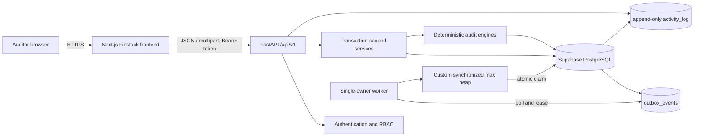
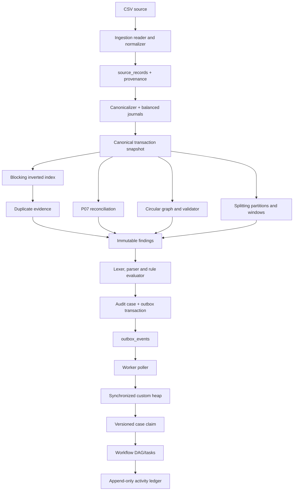

# Finstack complete integration and connection guide

This is the authoritative map of how every major part of Finstack connects—or
is intended to connect—from the browser through FastAPI, Supabase, the worker,
algorithms, audit evidence, and deployment. It distinguishes **implemented
module**, **live runtime connection**, and **pending production connection**.

Last verified: 30 October 2026.

## 1. Current integration truth

| Connection | Current state | Important detail |
|---|---|---|
| Browser → Next.js frontend | Connected locally | `npm run dev`, normally port 3000. |
| Frontend → FastAPI health | Not implemented in frontend | Backend health exists. |
| Frontend → ingestion API | Connected | Typed upload client and FastAPI CORS are configured. |
| Frontend → all other feature APIs | Connected | Fifteen routes use the typed API client. |
| FastAPI → ingestion service | Connected | Main app mounts ingestion router. |
| FastAPI ingestion → Supabase | Not connected | It uses `InMemoryIngestionRepository`. |
| FastAPI → Supabase engine/session | Infrastructure implemented | Engine/session factory exists but is not composed into feature routes. |
| Alembic → Supabase | Connected and verified | Database is at `0002_ingestion (head)`. |
| Feature routers → main FastAPI app | Connected | All P00–P19 API routes are mounted. |
| Worker → durable outbox/cases | Not connected | Worker service classes exist, but process composition only waits for signals. |
| P07 reconciliation | Implemented | Runtime Supabase ledger loader remains to be connected. |
| Docker services | Defined, not locally verified | Docker is absent on the current workstation. |
| Private Sites hosting | Identity created, source not uploaded | Upload/deployment requires explicit approval. |

The frontend and backend are integrated for the full demo pipeline. The remaining
production boundary is durable business-service persistence in Supabase.

## 2. Intended end-to-end topology



Rules of this topology:

- PostgreSQL is the durable authority.
- In-memory indexes, graphs and heaps are restartable projections.
- The browser never receives database credentials or a service-role key.
- Every mutation is authorized server-side and uses a transaction.
- Financial/audit evidence is not cascade-deleted.
- Detectors write findings, not directly to the worker heap.
- A case and its outbox event are committed atomically.

## 3. Processes, ports and URLs

| Process | Development command | Default address | State |
|---|---|---|---|
| Frontend | `cd frontend; npm run dev` | `http://localhost:3000` | Working |
| FastAPI | `cd backend; python -m uvicorn app.main:app --reload` | `http://127.0.0.1:8000` | Working |
| OpenAPI | FastAPI process | `http://127.0.0.1:8000/docs` | Working for mounted routes |
| Health | FastAPI process | `/api/v1/health` | Mounted |
| Worker | `cd backend; python -m app.worker.main` | No HTTP port | Starts but persistence loop is not composed |
| Supabase | Managed service | Pooler URL from `.env` | Connected for migrations/readiness checks |
| Local PostgreSQL | Docker Compose `local-db` profile | `localhost:5432` | Optional; not verified locally |

The Docker Compose file currently defines `api`, `worker`, and optional
`postgres`. It does **not** define a frontend service.

## 4. Configuration and environment connection

The root `.env` is loaded by `backend/app/config.py`. It is ignored by Git.
The backend normalizes a Supabase `postgresql://` URI to
`postgresql+psycopg://` for Psycopg 3.

### Backend variables

| Variable | Consumer | Purpose |
|---|---|---|
| `APP_NAME` | FastAPI health/title | Service display name; template still says AuditForge API. |
| `APP_ENV` | API/worker | Development/test/production identity. |
| `LOG_LEVEL` | API/worker | Structured application log level. |
| `DATABASE_URL` | Alembic and SQLAlchemy | Supabase or local PostgreSQL connection. |
| `DATABASE_POOL_SIZE` | SQLAlchemy | Persistent pool size, default 5. |
| `DATABASE_MAX_OVERFLOW` | SQLAlchemy | Extra connections, default 5. |
| `DATABASE_POOL_TIMEOUT` | SQLAlchemy | Pool wait limit, default 30 seconds. |
| `DATABASE_POOL_RECYCLE` | SQLAlchemy | Connection recycle interval, default 1800 seconds. |
| `API_HOST` / `API_PORT` | Intended runtime config | Present in template; Compose command currently fixes host/port directly. |
| `DB_BACKEND` | Documentation/template | Present but not consumed by `Settings`. |

### Frontend variable

| Variable | Consumer | Purpose |
|---|---|---|
| `NEXT_PUBLIC_API_BASE_URL` | `frontend/src/lib/api.ts` | FastAPI origin; defaults to `http://127.0.0.1:8000`. |

`NEXT_PUBLIC_API_BASE_URL` is safe because it is an origin, not a secret. It
should be added to a frontend environment template before deployment.

### Secrets that must remain server-only

- Supabase database password and full `DATABASE_URL`.
- Supabase service-role key if one is introduced.
- Session signing/encryption secrets if cookie sessions are introduced.
- Private deployment tokens and Sites repository credentials.

Do not put any of these in variables beginning with `NEXT_PUBLIC_`.

## 5. Browser-to-frontend route map

| Frontend route | Purpose | Data connection today |
|---|---|---|
| `/dashboard` | Operational summary | Live metrics API. |
| `/ingestion` | CSV upload/job status | Live multipart upload and processing result. |
| `/transactions` | Canonical transaction search | Live canonical API. |
| `/findings` | Circular/splitting findings | Live combined finding API. |
| `/cases` | Case queue, ownership and status | Live list and atomic claim. |
| `/rules` | Rule expression editor/lifecycle | Live validation and draft creation. |
| `/audit-log` | Immutable activity display | Authenticated live activity API. |
| `/login` | Authentication | Live server-side session login. |
| `/reconciliation` | P07 reconciliation | Live run endpoint. |
| `/patterns/circular` | Circular detector workflow | Live run and evidence list. |
| `/patterns/splitting` | Splitting detector workflow | Live run and evidence list. |
| `/workflow` | DAG/template workflow | Live DAG validation. |
| `/stress` | Development diagnostics | Live health and metrics. |

All user-facing routes share `frontend/src/components/audit-app.tsx` and call
the typed functions in `frontend/src/lib/api.ts`.

## 6. Frontend-to-API request contract

### Base behaviour

- Base URL: `NEXT_PUBLIC_API_BASE_URL`.
- API prefix: `/api/v1`.
- Success envelope: `{data, meta, request_id}`.
- Error envelope: `{error: {code, message, details}, request_id}`.
- Money: integer minor units; never binary floating point.
- Time: timezone-aware UTC ISO 8601.
- Pagination: `offset`, `limit` (1–500), `total`.
- Mutations: `Idempotency-Key`, 8–128 safe ASCII characters.
- Traceability: `X-Request-ID` request header and response header/body.
- Authenticated calls: `Authorization: Bearer <session token>`.

### Current ingestion request

```text
POST /api/v1/ingestion/jobs
Content-Type: multipart/form-data
Idempotency-Key: ui-<uuid>
X-Request-ID: <uuid>

file=<CSV binary>
source_system=<string>
```

The current frontend generates a new key per submit. A production client must
retain the same key for retries of the same user action and poll
`GET /api/v1/ingestion/jobs/{job_id}` until `COMPLETED` or `FAILED`.

### Required CORS connection

Frontend development uses port 3000 and API development uses port 8000, so they
are different browser origins. `app.main` now configures an environment-driven
allowlist using `CORS_ORIGINS`, for example:

```text
http://localhost:3000
https://<approved-production-frontend-origin>
```

Allow only required methods/headers, including `Authorization`,
`Idempotency-Key`, `X-Request-ID`, and multipart uploads. Never use wildcard
origins with credentials.

## 7. Backend API connection inventory

“Declared” means a router function exists. “Mounted” means reachable through
the actual `app.main` runtime.

| Method and path | Router module | Declared | Mounted | Persistence |
|---|---|---:|---:|---|
| `GET /health` | `main.py` | yes | yes | none |
| `POST /ingestion/jobs` | `ingestion.py` | yes | yes | in-memory |
| `GET /ingestion/jobs/{id}` | `ingestion.py` | yes | yes | in-memory |
| `GET /transactions` | `transactions.py` | yes | yes | repository protocol/reference |
| `GET /duplicates` | `duplicates.py` | yes | yes | repository protocol/reference |
| `POST /detectors/circular/runs` | `detectors.py` | yes | yes | in-memory/reference |
| `POST /detectors/splitting/runs` | `detectors.py` | yes | yes | in-memory/reference |
| `GET /findings` | `detectors.py` | yes | yes | in-memory/reference |
| `POST /rules/validate` | `rules.py` | yes | yes | none for validation |
| `POST /rules` | `rules.py` | yes | yes | in-memory/reference |
| `POST /rules/{id}/activate` | `rules.py` | yes | yes | in-memory/reference |
| `GET /cases` | `cases.py` | yes | yes | in-memory/reference |
| `POST /cases/{id}/claim` | `cases.py` | yes | yes | in-memory/reference |
| `POST /cases/{id}/transition` | `cases.py` | yes | yes | in-memory/reference |
| `POST /workflows/validate` | `workflows.py` | yes | yes | none for validation |
| `POST /workflows/templates` | `workflows.py` | yes | yes | in-memory/reference |
| `GET /cases/{id}/workflow` | `workflows.py` | yes | yes | in-memory/reference |
| `POST /auth/login` | `auth.py` | yes | yes | in-memory/reference session store |
| `POST /auth/logout` | `auth.py` | yes | yes | in-memory/reference session store |
| `GET /activity` | `activity.py` | yes | yes | in-memory/reference ledger |
| Reconciliation routes | `reconciliation.py` | yes | yes | in-memory/reference |
| Metrics/aggregates | `metrics.py` | yes | yes | in-memory/reference |

The path column omits the common `/api/v1` prefix.

## 8. Backend module and service connections



### Module boundaries

- `app/ingestion`: transport parsing, normalization, source/canonical identity.
- `app/engines/identity`: blocking, Soundex, edit distance, evidence only.
- `app/engines/reconciliation`: one-to-one matching, journal balance and runs.
- `app/engines/circular`: directed multigraph, bounded DFS, temporal validation.
- `app/engines/splitting`: partitioning, bounded sliding windows and findings.
- `app/engines/rules`: lexer, parser, AST, evaluation and priority.
- `app/engines/queue`: custom heap, synchronized queue and claim service.
- `app/engines/workflow`: DAG, cycle detection, topological order and tasks.
- `app/services`: transaction/case/outbox orchestration boundaries.
- `app/core`: auth, RBAC, idempotency, error and activity primitives.
- `app/db`: SQLAlchemy metadata and session lifecycle.
- `app/worker`: single heap owner and durable queue projection.

## 9. Supabase and SQLAlchemy connection

### What is live

- `.env` supplies a valid pooler URL.
- Psycopg 3 reaches Supabase PostgreSQL.
- Alembic migrations `0001_normalized` and `0002_ingestion` are applied.
- Read-only verification reported PostgreSQL 17.11, `max_connections=60`, and
  migration head `0002_ingestion`.
- `create_database_engine()` configures pre-ping, bounded pool size/overflow,
  timeout and recycle.
- `transaction_session()` commits on success and rolls back on failure.

### What is not live

- `create_database_engine()` and the session factory are not created in
  `app.main` lifespan/startup.
- Feature repository protocols have no composed SQLAlchemy implementations.
- Ingestion does not write its four database tables at runtime.
- Auth sessions and activity operations are not using database transactions.
- Case, outbox and activity writes are not yet committed atomically.

### Transaction requirements

Each API mutation must receive a scoped SQLAlchemy `Session` and complete all
related writes within one transaction. Required atomic groups include:

- Accepted source row + provenance + job checkpoint/error.
- Canonical transaction + source link + journal + journal lines.
- Detector run + findings + evidence.
- Rule activation + retirement of the previous active version + activity.
- Case + case findings + outbox event + activity intent.
- Case claim/transition + workflow unlock + append-only activity.

## 10. Database relationship map

The migrated schema contains 30 tables.

### Reference and identity

- `branches` → parent of `accounts`.
- `accounts.branch_id` → `branches.id`.
- `source_systems` → parent of source records, files and ingestion jobs.
- `users` ↔ `roles` through `user_roles`.

### Ingestion and financial provenance

- `ingestion_jobs.source_system_id` → `source_systems.id`.
- `source_files.source_system_id` → `source_systems.id`.
- `ingestion_source_rows.job_id` → `ingestion_jobs.id`.
- `ingestion_source_rows.source_file_id` → `source_files.id`.
- `ingestion_source_rows.source_record_id` → `source_records.id`.
- `ingestion_row_errors.job_id` → `ingestion_jobs.id`.
- `source_records.source_system_id` → `source_systems.id`.
- `source_record_links` connects source records to canonical transactions.
- `canonical_transactions` references sender/receiver accounts and optional
  reversal transaction.
- `journals.canonical_transaction_id` → `canonical_transactions.id`.
- `journal_lines` references journal, account and source record.

### Detection, rules and reconciliation

- `findings.detector_run_id` → `detector_runs.id`.
- `finding_evidence` connects findings to canonical transactions.
- `reconciliation_results.run_id` → `reconciliation_runs.id`.
- Reconciliation results optionally reference internal and counterpart
  canonical transactions; runtime producer is missing with P07.
- `audit_rule_versions.rule_id` → `audit_rules.id`.
- Rule versions reference creator users.

### Cases, workflow, audit and messaging

- `audit_cases.rule_version_id` → `audit_rule_versions.id`.
- `audit_cases.assignee_id` → `users.id`.
- `case_findings` connects cases to findings.
- `workflow_task_templates.template_id` → `workflow_templates.id`.
- `workflow_dependencies` connects prerequisite/dependent task templates.
- `case_workflow_tasks` references case, task template and optional assignee.
- `activity_log.actor_id` → `users.id`; database protections make it append-only.
- `outbox_events` stores durable logical events by entity/version and payload
  hash; it intentionally avoids a broad cascade relationship.

All evidence-preserving foreign keys use `RESTRICT` rather than cascade delete.

## 11. Authentication, authorization and session connection

### Implemented modules

- Password hashing and constant-time verification.
- Expiring server-side bearer session objects.
- Login/logout router.
- Roles: `ADMIN`, `AUDITOR`, `REVIEWER`, `VIEWER`.
- Permission checks and maker-checker separation.
- Append-only activity primitives and hash-chain verification.

### Missing runtime connections

- Auth/activity routers are not mounted.
- User/session repositories are not connected to Supabase.
- Several routers still use temporary `X-Actor-ID`/`X-Roles` integration
  headers rather than P18 authentication dependencies.
- Frontend login/token lifecycle is not implemented.
- Token storage/refresh/cookie policy is not finalized.

Production must use server-side authorization even when the frontend hides an
action. The recommended browser connection is secure HttpOnly session cookies;
if bearer tokens remain, keep them in memory and never local storage.

## 12. Worker, outbox and heap connection

The intended sequence is:

1. A service commits a case and `CASE_QUEUED` outbox event atomically.
2. The dedicated worker polls bounded `PENDING` events with a lease and
   `FOR UPDATE SKIP LOCKED`.
3. It projects case IDs/priority/version into one synchronized max heap.
4. A worker thread pops a candidate, then performs the database claim outside
   the heap lock using expected row version.
5. One claim wins; stale contenders receive a conflict.
6. Expired leases can be recovered and re-enqueued idempotently.

Current reality:

- `CaseWorker`, `OutboxService`, `ClaimService` and queue algorithms exist and
  have concurrency tests.
- `app.worker.main()` does not construct a repository or `CaseWorker`; it only
  logs startup, waits for a signal and logs shutdown.
- Production SQL queries and polling loop still need composition.

## 13. Error, retry and idempotency connections

| Situation | Expected connection behaviour |
|---|---|
| Exact mutation retry | Return original result using same idempotency key. |
| Same key, changed payload | HTTP 409 `IDEMPOTENCY_CONFLICT`. |
| Stale case version | HTTP 409; refetch and preserve user input. |
| Missing/expired session | HTTP 401; clear frontend session. |
| Insufficient role | HTTP 403; backend rejects regardless of UI. |
| Validation failure | HTTP 400/422 with stable diagnostic details. |
| Missing record | HTTP 404. |
| Rate limit | HTTP 429; respect `Retry-After`. |
| Unexpected failure | HTTP 500 with request ID; no secret/internal traceback. |

The frontend must retry reads safely. It must not automatically retry a
mutation with a different idempotency key.

## 14. Observability connection

Implemented:

- Each FastAPI request gets or reuses an `X-Request-ID`.
- Response includes the request ID header.
- Structured request completion/failure JSON is logged.
- Algorithm/queue services expose deterministic counters and test metrics.

Pending:

- Shared request ID inside every response body/error path.
- Worker/job correlation IDs in persistent activity/outbox records.
- Production metrics endpoint and dashboard aggregates.
- Central log/metric exporter, alerts and retention policy.
- Health/readiness distinction for database and worker dependencies.

## 15. Deployment connection map

### Intended production

```text
Browser
  -> HTTPS frontend origin
  -> HTTPS FastAPI origin or same-origin reverse proxy
  -> Supabase transaction/session pooler
  -> dedicated worker using the same durable database
```

Recommended connection controls:

- Terminate TLS at the hosting/reverse-proxy boundary.
- Prefer same-origin `/api` proxying to simplify CORS and secure cookies.
- Use separate API and worker processes.
- Use bounded SQLAlchemy pools below Supabase capacity.
- Run Alembic as a controlled release step, not concurrently in every replica.
- Configure health/readiness probes and graceful shutdown.
- Confirm Supabase backup/PITR settings in its dashboard.
- Deploy the generated frontend image with its environment-specific API origin.

### Current deployment gaps

- No production host for FastAPI/worker is configured.
- Private Sites source was not uploaded or deployed.
- Docker/Compose has not run locally.
- CORS is configured; production origins must be supplied through the environment.
- Environment-specific frontend/API URLs are not documented in deployment IaC.

## 16. Required final-integration implementation order

1. Implement and test P07 reconciliation plus non-empty frozen fixtures.
2. Create SQLAlchemy repository adapters for ingestion, transactions, detector
   runs/findings, rules, cases/outbox/workflows, auth/sessions and activity.
3. Add FastAPI lifespan composition for engine/session factories and adapters.
4. Replace temporary actor headers with P18 authentication/RBAC dependencies.
5. Mount all routers once, avoiding duplicate `/findings` route conflicts.
6. Add environment-driven CORS or a same-origin frontend API proxy.
7. Add frontend environment template and implement login/session handling.
8. Add polling for long-running remote jobs when detector execution becomes asynchronous.
9. Compose the worker repository, polling loop, leases and graceful shutdown.
10. Add aggregate/metrics endpoints required by the dashboard.
11. Add end-to-end tests using seeded PostgreSQL/Supabase test data.
12. Verify Python 3.12 containers, Docker Compose, backups and deployment.
13. Upload/deploy the frontend only with explicit source authorization.
14. Rerun `make release-check` and update `docs/test-report.md`.

## 17. Connection acceptance checklist

### Frontend/API

- [ ] Login/logout/session expiry work through the browser.
- [ ] CORS or same-origin proxy is verified for every required header/method.
- [ ] Every frontend screen uses live API data or is explicitly unavailable.
- [ ] Pagination, request IDs, error envelopes and idempotency are consistent.
- [ ] No credentials/tokens appear in client bundles, URLs or logs.

### API/database

- [ ] Every feature router is mounted and protected by correct permissions.
- [ ] Every repository uses a scoped SQLAlchemy transaction.
- [ ] Restarting API/worker does not lose jobs, cases, sessions or activity.
- [ ] Re-import creates no duplicate source/canonical identity.
- [ ] Case/outbox/activity atomicity is proven against PostgreSQL.

### Worker

- [ ] Durable queue rebuild works after restart.
- [ ] Poll/claim leases recover safely.
- [ ] Concurrent claims produce one winner and no lost work.
- [ ] No database/network operation occurs while heap mutex is held.

### Release/deployment

- [x] P07 is complete with fixture and API evidence.
- [ ] Full unit/integration/stress/end-to-end suites pass.
- [ ] Docker/services and Python 3.12 runtime pass.
- [ ] Supabase migrations, capacity, backups and restore procedure are verified.
- [ ] Frontend/API/worker production URLs and secrets are configured.
- [ ] Phase 20 test report contains no open release blockers.

## 18. Verification commands

```powershell
# Backend
cd backend
python -m pytest -q -p no:cacheprovider
python -m ruff check app tests scripts alembic
python -m mypy --strict app scripts
python -m alembic current

# Frontend
cd ..\frontend
npm run typecheck
npm run build

# Entire release gate from project root
cd ..
make release-check

# Containers, once Docker is installed
docker compose config --quiet
docker compose up --build api worker
```

## 19. Source-of-truth files

| Subject | File |
|---|---|
| Runtime API composition | `backend/app/main.py` |
| Environment loading | `backend/app/config.py` |
| Database sessions | `backend/app/db/session.py` |
| Database models | `backend/app/db/models/*.py` |
| Migrations | `backend/alembic/versions/*.py` |
| Worker composition | `backend/app/worker/main.py` |
| API route contracts | `docs/api-contract.md`, `backend/app/api/v1/*.py` |
| Frontend API client | `frontend/src/lib/api.ts` |
| Frontend domain types | `frontend/src/lib/types.ts` |
| Frontend UI contract | `docs/phase19-frontend-requirements.md` |
| Schema relationship notes | `docs/schema-erd.md` |
| Architecture boundaries | `docs/architecture.md` |
| Verification status | `docs/test-report.md` |
| Phase status | `docs/phase-status.md` |
| Deployment services | `docker-compose.yml`, `Makefile` |

When code and older prose disagree, runtime composition and tests describe what
is actually connected. Update this document whenever a pending connection is
made live.
