# Relational Schema & Entity-Relationship Specification (3NF)

This document formalizes the 3NF relational schema, constraints, indexing strategies, and entity relationships for the Track 2 Concurrent Banking Audit Platform.

---

## 1. Architectural Integrity Invariants

1. **Strict 3NF Normalization**:
   - Branch attributes reside exclusively in `branches`.
   - Account currency and masking reside in `accounts`.
   - User security and roles are separated via `users`, `roles`, and `user_roles`.
   - Detector configurations and versions are decoupled from individual findings.

2. **No Cascading Deletes on Financial & Audit Evidence**:
   - All foreign keys on transactions, accounts, branches, source records, findings, journals, and audit cases enforce `ON DELETE RESTRICT` (or `NO ACTION`).
   - Economic events and audit findings can never be wiped out accidentally by parent record deletion.

3. **Append-Only Immutability on Audit History**:
   - `activity_log` is strictly append-only.
   - At the database level, a trigger (`prevent_activity_log_tampering`) raises an exception on any attempt to execute `UPDATE`, `DELETE`, or `TRUNCATE`.

4. **Deterministic Money & Integer Minor Units**:
   - All monetary amounts use integer minor units (paise for INR; e.g., ₹25,000 = `2500000`).
   - Floats are forbidden by schema and application contracts.
   - CHECK constraints enforce `amount_minor > 0` on canonical transactions and valid positive double-entry postings on journal lines.

---

## 2. Mermaid Entity-Relationship Diagram

```mermaid
erDiagram
    branches ||--o{ accounts : "has"
    branches ||--o{ journals : "records"
    
    accounts ||--o{ transactions : "sends"
    accounts ||--o{ transactions : "receives"
    accounts ||--o{ journal_lines : "postings"
    
    journals ||--|{ journal_lines : "contains"
    
    source_systems ||--o{ ingestion_jobs : "generates"
    source_systems ||--o{ source_records : "provides"
    source_systems ||--o{ reconciliation_runs : "source_left"
    source_systems ||--o{ reconciliation_runs : "source_right"
    
    ingestion_jobs ||--o{ source_records : "batches"
    
    source_records ||--o{ source_record_transactions : "maps"
    transactions ||--o{ source_record_transactions : "mapped_by"
    
    detector_configs ||--o{ findings : "configures"
    findings ||--o{ finding_transactions : "evidenced_by"
    transactions ||--o{ finding_transactions : "involved_in"
    
    findings ||--o{ case_findings : "grouped_in"
    audit_cases ||--o{ case_findings : "groups"
    
    users ||--o{ user_roles : "assigned"
    roles ||--o{ user_roles : "grants"
    users ||--o{ rules : "authors"
    users ||--o{ audit_cases : "claims"
    users ||--o{ activity_log : "performs"
    
    workflow_templates ||--|{ workflow_task_templates : "defines"
    workflow_templates ||--o{ workflow_edges : "sequences"
    workflow_task_templates ||--o{ workflow_edges : "predecessor"
    workflow_task_templates ||--o{ workflow_edges : "successor"
    
    audit_cases ||--o{ case_tasks : "tracks"
    workflow_task_templates ||--o{ case_tasks : "instantiates"
    
    reconciliation_runs ||--o{ reconciliation_results : "produces"
    source_records ||--o{ reconciliation_results : "left_rec"
    source_records ||--o{ reconciliation_results : "right_rec"

    branches {
        string id PK
        string code UK
        string name
        timestamptz created_at
    }

    accounts {
        string id PK
        string branch_id FK
        string currency
        string masked_label
        timestamptz created_at
    }

    source_systems {
        string id PK
        string name UK
        string description
        timestamptz created_at
    }

    ingestion_jobs {
        string id PK
        string source_system_id FK
        timestamptz received_at
        string state
        json counts_json
    }

    source_records {
        string id PK
        string ingestion_job_id FK
        string source_system_id FK
        string external_ref
        int source_revision
        json payload_json
        string payload_hash
        timestamptz received_at
        string record_status
    }

    transactions {
        string id PK
        string external_canonical_ref UK
        string sender_account_id FK
        string receiver_account_id FK
        bigint amount_minor "CHECK > 0"
        string currency
        timestamptz occurred_at
        timestamptz posted_at
        string txn_type
        string status
    }

    source_record_transactions {
        string source_record_id PK,FK
        string transaction_id PK,FK
        string link_type
    }

    journals {
        string id PK
        string branch_id FK
        timestamptz posted_at
        string journal_ref UK
        string status
    }

    journal_lines {
        string id PK
        string journal_id FK
        string account_id FK
        bigint debit_minor
        bigint credit_minor
    }

    reconciliation_runs {
        string id PK
        string source_left_id FK
        string source_right_id FK
        timestamptz start_at
        timestamptz cutoff_at "CHECK cutoff > start"
        string policy_version_id
        string input_checkpoint
        string status
    }

    reconciliation_results {
        string id PK
        string run_id FK
        string left_record_id FK
        string right_record_id FK
        string status
        bigint variance_minor
        string reason_code
    }

    detector_configs {
        string id PK
        string detector_type
        int version
        json config_json
        string status
    }

    findings {
        string id PK
        string finding_type
        string fingerprint UK
        string detector_config_id FK
        string algorithm_version
        string status
        json evidence_json
        timestamptz created_at
    }

    finding_transactions {
        string finding_id PK,FK
        string transaction_id PK,FK
        int path_position
    }

    rules {
        string id PK
        string name
        int version
        text expression
        string status
        string created_by FK
        timestamptz activated_at
    }

    audit_cases {
        string id PK
        string case_code UK
        string state
        int priority "CHECK 0..100"
        int row_version
        string assignee_id FK
        timestamptz lease_until
        timestamptz created_at
    }

    case_findings {
        string case_id PK,FK
        string finding_id PK,FK
    }

    workflow_templates {
        string id PK
        string name
        int version
        string status
        timestamptz created_at
    }

    workflow_task_templates {
        string id PK
        string template_id FK
        string stable_key
        string display_name
        text description
    }

    workflow_edges {
        string template_id PK,FK
        string predecessor_template_task_id PK,FK
        string successor_template_task_id PK,FK
    }

    case_tasks {
        string id PK
        string case_id FK
        string task_template_id FK
        string state
        timestamptz completed_at
        int row_version
    }

    users {
        string id PK
        string username UK
        string password_hash
        string status
        timestamptz created_at
    }

    roles {
        string id PK
        string name UK
        string description
    }

    user_roles {
        string user_id PK,FK
        string role_id PK,FK
    }

    activity_log {
        string id PK
        string actor_user_id FK
        string actor_type
        timestamptz occurred_at
        string action_type
        string entity_type
        string entity_id
        json old_value
        json new_value
        string correlation_id
    }

    outbox_events {
        string id PK
        string event_type
        string entity_id
        json payload_json
        string status
        int attempt_count
        timestamptz created_at
        timestamptz claimed_at
        string payload_hash
    }
```

---

## 3. Explicit PRD Indexes Catalog

| Target Table | Columns Indexed | Index Type | Purpose / Query Optimization |
| :--- | :--- | :--- | :--- |
| `transactions` | `(occurred_at, sender_account_id)` | B-Tree | Temporal sender fund-flow traversal & sliding windows |
| `transactions` | `(receiver_account_id, occurred_at)` | B-Tree | Inbound counterparty velocity analysis & circular DFS |
| `source_records` | `(source_system_id, external_ref)` | B-Tree | Fast lookup for idempotent deduplication and updates |
| `findings` | `(finding_type, created_at)` | B-Tree | Filtering audit findings by detector type and timestamp |
| `audit_cases` | `(state, priority)` | B-Tree | Heap recovery and highest-priority case polling |
| `case_tasks` | `(case_id, state)` | B-Tree | Fast prerequisite evaluation in workflow DAG scheduling |
| `activity_log` | `(entity_type, entity_id, occurred_at)` | B-Tree | Audit trail chronological timeline queries per entity |
| `outbox_events` | `(status, created_at)` | B-Tree | Outbox worker claim queue polling |
